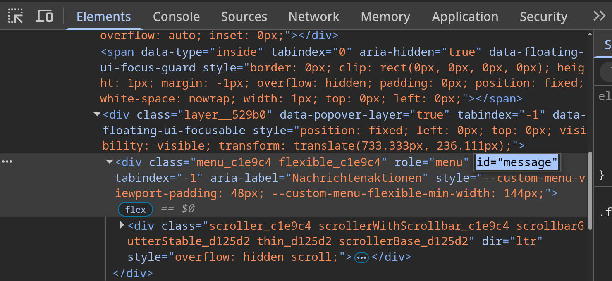
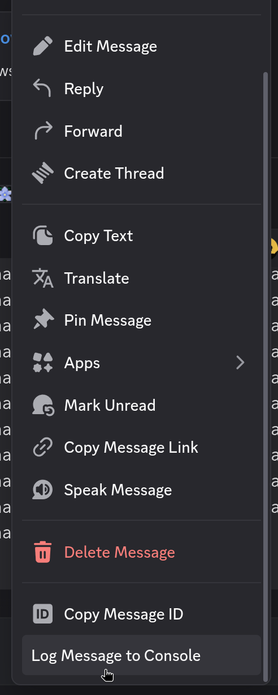
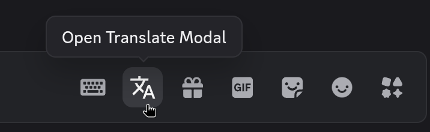
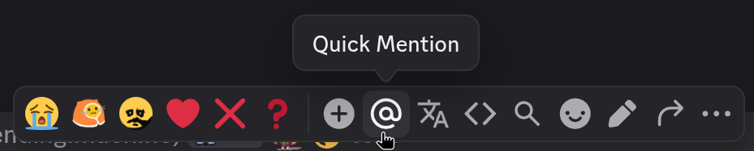
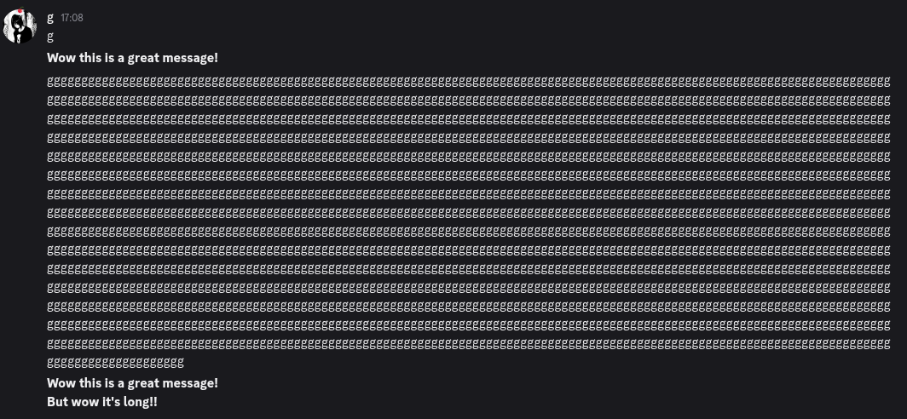
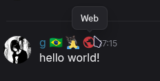
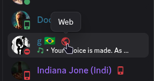

import { Tabs, TabItem } from "@astrojs/starlight/components";

Equicord provides declarative plugin fields for settings, commands, message events, and UI elements. Prefer these fields over registering and removing API handlers yourself.

This doc's purpose is to give a quick overview, it won't explain how to use them in-depth. For more detailed information, look at other plugins that use these APIs.

## Before Using the Examples

Start with a plugin that includes all three required fields:

```ts
import { EquicordDevs } from "@utils/constants";
import definePlugin from "@utils/types";

export default definePlugin({
    name: "MyCoolPlugin",
    description: "Demonstrates Equicord plugin APIs.",
    authors: [EquicordDevs.YourName]
});
```

Replace `EquicordDevs.YourName` with your registered author entry before building. For official Equicord plugins, follow [Basic Plugin Setup](/plugins/) and the [submission guide](/plugins/submission/). For a private user plugin, the setup guide explains how to provide author metadata directly.

## Plugin Settings

Create settings with `definePluginSettings` and include `settings` in your plugin definition. Outside React, read `settings.store.coolFeature` and assign to it to change the value. In a React component, use `settings.use` to subscribe to specific keys.

```tsx
// Define settings. This will return a reactive settings object.
// - To read: `const enableFeature = settings.store.coolFeature`
// - To write: `settings.store.coolFeature = false`
import { definePluginSettings } from "@api/Settings";
import ErrorBoundary from "@components/ErrorBoundary";
import { Paragraph } from "@components/Paragraph";
import { OptionType } from "@utils/types";

const settings = definePluginSettings({
    coolFeature: {
        type: OptionType.BOOLEAN,
        description: "Enable the example feature.",
        default: true
    }
});

const SETTING_KEYS: Array<"coolFeature"> = ["coolFeature"];

const SettingsPreview = ErrorBoundary.wrap(function SettingsPreview() {
    const { coolFeature } = settings.use(SETTING_KEYS);

    return (
        <Paragraph>
            {coolFeature ? "The example feature is enabled." : "The example feature is disabled."}
        </Paragraph>
    );
}, { noop: true });
```

Add `settings` and `settingsAboutComponent: SettingsPreview` to your plugin definition. The preview renders above the settings controls. Keeping the subscription keys at module scope avoids creating a new subscription array on every render.

For additional setting types, defaults, validation, and migrations, see the [settings API](https://github.com/Equicord/Equicord/blob/main/src/api/Settings.ts) and [setting types](https://github.com/Equicord/Equicord/blob/main/src/utils/types.ts).

## Slash Commands

Register a slash command `/hello-world` that displays a local "Hello World!" response. It does not send a message to other users. Commands can also define arguments and subcommands.

```ts
import { sendBotMessage } from "@api/Commands";
import type { PluginDef } from "@utils/types";

const commands = [{
    name: "hello-world",
    description: "Display a local greeting.",
    execute(_args, ctx) {
        sendBotMessage(ctx.channel.id, { content: "Hello World!" });
    }
}] satisfies NonNullable<PluginDef["commands"]>;
```

Include `commands` in your plugin definition. For command options, use `findOption` from `@api/Commands` instead of reading arguments by array position. See the [commands API](https://github.com/Equicord/Equicord/blob/main/src/api/Commands/index.ts).

:::note
This demonstrates the API, not a plugin submission idea. Simple slash-command-only plugins are not accepted under the [submission rules](/plugins/submission/).
:::

## Context Menus

Use `contextMenus` to modify a context menu's children in place. Each menu has a navigation ID; the message context menu uses `message`.

<Tabs syncKey="context-menu">
    <TabItem label="index.tsx" icon="seti:react">
        ```tsx
        import type { PluginDef } from "@utils/types";
        import { Menu, showToast } from "@webpack/common";

        const contextMenus = {
            message(children) {
                children.push(
                    <Menu.MenuItem
                        id="vc-my-cool-plugin-example"
                        key="vc-my-cool-plugin-example"
                        label="Show Example Toast"
                        action={() => showToast({ text: "The example menu item was clicked." })}
                    />
                );
            }
        } satisfies NonNullable<PluginDef["contextMenus"]>;
        ```

        Include `contextMenus` in your plugin definition. `Menu` is a named export from `@webpack/common`; `definePlugin` is the default export from `@utils/types` used in the base plugin above.

        To insert an item into an existing group, use `findGroupChildrenByChildId` from `@api/ContextMenu`. Returning a new children array does not replace the menu.
    </TabItem>

    <TabItem label="Finding the ID" icon="seti:code-search">
        - Open browser DevTools.
        - Open the context menu you want to modify in Discord.
        - Inspect the menu in the Elements panel and locate its ID.

        
    </TabItem>

    <TabItem label="Screenshot" icon="seti:image">
        
    </TabItem>
</Tabs>

See the [context menu API](https://github.com/Equicord/Equicord/blob/main/src/api/ContextMenu.ts) for group lookup and imperative registration helpers.

## Chat Bar Buttons

Chat bar buttons appear beside Discord's gift, GIF, sticker, and emoji controls.



The `chatBarButton` field takes `{ icon, render }`. Its `icon` is used in `Settings > Equicord > Plugins > Manage Plugin UI Elements`. The render function must also render the visible icon inside a `ChatBarButton`.

```tsx
import { ChatBarButton } from "@api/ChatButtons";
import type { ChatBarButtonFactory } from "@api/ChatButtons";
import ErrorBoundary from "@components/ErrorBoundary";
import { InfoIcon } from "@components/Icons";
import type { PluginDef } from "@utils/types";
import { showToast } from "@webpack/common";

function ExampleChatButton({ isMainChat }: Parameters<ChatBarButtonFactory>[0]) {
    if (!isMainChat) return null;

    return (
        <ChatBarButton
            tooltip="Show example toast"
            onClick={() => showToast({ text: "The example chat button was clicked." })}
        >
            <InfoIcon />
        </ChatBarButton>
    );
}

const SafeExampleChatButton = ErrorBoundary.wrap(ExampleChatButton, { noop: true });

const chatBarButton = {
    icon: InfoIcon,
    render: props => <SafeExampleChatButton {...props} />
} satisfies NonNullable<PluginDef["chatBarButton"]>;
```

Include `chatBarButton` in your plugin definition. Reusing `ChatBarButton` preserves Discord's tooltip, focus, and accessibility behavior. See the [API types](https://github.com/Equicord/Equicord/blob/main/src/api/ChatButtons.tsx) and [SilentTyping implementation](https://github.com/Equicord/Equicord/blob/main/src/plugins/silentTyping/index.tsx).

## Message Events

React to message interactions by adding the corresponding handler to your plugin definition. Equicord manages registration and cleanup automatically.

<Tabs syncKey="message-events">
    <TabItem label="Click">
        **`onMessageClick(message, channel, event)`**

        Runs when the user clicks a message. Use the message, channel, and mouse event to handle the interaction. Returns `void`.
    </TabItem>
    <TabItem label="Send">
        **`onBeforeMessageSend(channelId, message, options, props)`**

        Runs before a message is sent. Change `message.content` to update the outgoing text, or return `{ cancel: true }` to stop the send. Supports asynchronous handlers.
    </TabItem>
    <TabItem label="Edit">
        **`onBeforeMessageEdit(channelId, messageId, message)`**

        Runs before an edit is applied. Change `message.content` to update the edited text, or return `{ cancel: true }` to stop the edit. Supports asynchronous handlers.
    </TabItem>
</Tabs>

See the [message event types](https://github.com/Equicord/Equicord/blob/main/src/api/MessageEvents.ts) for the full payload definitions. Avoid logging message contents or other sensitive data when debugging.

## Message Popover Buttons

The message popover is the toolbar shown when hovering over a message.



The `messagePopoverButton` field also takes `{ icon, render }`, but its `render` function receives a message and returns a **button descriptor or `null`**, not a React element. The descriptor contains the visible `label`, `icon`, and action handlers.

```tsx
import { InfoIcon } from "@components/Icons";
import type { PluginDef } from "@utils/types";
import { showToast } from "@webpack/common";

const messagePopoverButton = {
    icon: InfoIcon,
    render(message) {
        if (message.state === "SENDING") return null;

        return {
            label: "Show Example Toast",
            icon: InfoIcon,
            onClick: () => showToast({ text: "The example message button was clicked." })
        };
    }
} satisfies NonNullable<PluginDef["messagePopoverButton"]>;
```

Include `messagePopoverButton` in your plugin definition. See the [popover API](https://github.com/Equicord/Equicord/blob/main/src/api/MessagePopover.tsx) and [QuickMention implementation](https://github.com/Equicord/Equicord/blob/main/src/plugins/quickMention/index.tsx).

## Message Accessories

Accessories appear below a message, alongside content such as embeds. `renderMessageAccessory` is a render function, not an object containing `render` or `position`.

```tsx
import type { MessageAccessoryFactory } from "@api/MessageAccessories";
import ErrorBoundary from "@components/ErrorBoundary";
import { Paragraph } from "@components/Paragraph";
import type { Message } from "@vencord/discord-types";

interface AccessoryProps {
    message: Message;
}

const ExampleAccessory = ErrorBoundary.wrap(function ExampleAccessory({ message }: AccessoryProps) {
    if (message.content.length <= 1000) return null;

    return <Paragraph>This message contains more than 1,000 characters.</Paragraph>;
}, { noop: true });

const renderMessageAccessory: MessageAccessoryFactory = props => <ExampleAccessory message={props.message} />;
```

Include `renderMessageAccessory` in your plugin definition.



See the [accessory API](https://github.com/Equicord/Equicord/blob/main/src/api/MessageAccessories.tsx). If you need imperative registration, such as multiple accessories or a custom position, pair `addMessageAccessory` with `removeMessageAccessory` and declare `dependencies: ["MessageAccessoriesAPI"]`.

## Message Decorations



`renderMessageDecoration` renders beside the message author's name. It is a function receiving `MessageDecorationProps` and returning a JSX element or `null`. Wrap the component with `ErrorBoundary.wrap(Component, { noop: true })` and assign it directly to the plugin field.

See the [decoration API and props](https://github.com/Equicord/Equicord/blob/main/src/api/MessageDecorations.tsx).

## Member List Decorations

Add decorations beside users in the member or DM list by defining `renderMemberListDecorator` on your plugin object.



The function receives `DecoratorProps` and returns a JSX element, or `null` when no decoration should be shown. Use `props.type` to distinguish guild members from DM entries, and wrap your component with `ErrorBoundary.wrap(Component, { noop: true })`.

See the [member list decorator API](https://github.com/Equicord/Equicord/blob/main/src/api/MemberListDecorators.tsx) for the available props.
